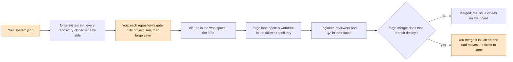

# se-forge: the guide

From zero to an app built from client requirements, or to changes in a system that already exists. Eight parts:
- **A.** Set up GitLab, once for the company.
- **B.** Set up each MacBook, once per person.
- **C.** Start a new app from client requirements.
- **D.** Day to day.
- **E.** Measure and improve: where the time and the money go.
- **F.** An existing system of several repositories (system mode, first phase).
- **G.** Configuration: a project whose tickets live in OpenProject.
- **H.** Configuration: agents on a self-hosted model server instead of Claude.

The examples use **https://gitlab.example.com** for your GitLab server: replace it with your server's address,
and `<group>` with your GitLab group's name, for example `ai`, everywhere. To be sure, open any project in GitLab
and click **Code**: the "Clone with SSH" address is `git@gitlab.example.com:<group>/<project>.git`.

## The whole flow

Orange: you do it or decide it, and the agents wait for you there. Purple: the agents do it, and Claude Code asks you before anything risky.

```mermaid
flowchart TD
  subgraph once["Once"]
    A["A. GitLab: the group, the team repo, the kit, a CI runner"] --> B["B. Each MacBook: tools, SSH key, glab, forge, Figma"]
  end
  subgraph app["C1-C4. A new app"]
    C1["C1. A GitLab project for the app"] --> C2["C2. forge init: branches dev and staging"]
    C2 --> C3["C3. Protect the branches in GitLab"]
    C3 --> C4["C4. The client's requirements and screens into the team repo"]
  end
  subgraph boot["C5. /bootstrap"]
    D1["Stage 1 · Discovery: what the requirements leave open"] --> D1a["You answer, in rounds: the decision register"]
    D1a --> D2["Stage 2 · User stories and who may do what"]
    D2 --> D3["Stage 3 · Architecture: diagrams, decisions, targets"]
    D3 --> D4["Stage 4 · Screens: designed in Figma, or taken from the client's"]
    D4 --> D5["Stage 5 · API contract"]
    D5 --> D6["Stage 6 · Ticket drafts with estimates"]
    D6 --> D6a["Stage 7 · The panel: backend, frontend, database, security, QA, architect and project manager review the drafts"]
    D6a --> D7{"Stage 8 · One review, the panel's result first: you approve, or say what to change"}
    D7 -- "change: that stage runs again" --> D2
    D7 -- "approve" --> D8["Stage 9 · Merge requests: architecture, contract, starter code"]
    D8 --> D9["You merge them in GitLab and approve the tag api-v1.0.0"]
    D9 --> D10["The tickets are created in GitLab, labelled ai::ready"]
  end
  subgraph sys["F. An existing system of several repositories"]
    S1["system.json: the repositories, their branches and what deploys"] --> S2["forge system init: every repository cloned side by side; nothing on GitLab changes"]
    S2 --> S3["Each repository's gate, then forge save"]
    S3 --> S4["The tickets on the system's board, one repository each"]
  end
  subgraph build["C6. /pipeline"]
    E1["Project manager: the next ready ticket"] --> E2["Planner: the plan and its estimate, answered from the decision register"]
    E2 --> Q{"Questions the register, your earlier answers and the sources do not answer?"}
    Q -- "yes" --> Q1["You answer them, in one message"]
    Q -- "no" --> K{"Does the API change?"}
    Q1 --> K
    K -- "yes" --> K1["You merge the contract change and tag it"]
    K -- "no" --> G{"Security or architecture?"}
    K1 --> G
    G -- "yes" --> G1["You approve the plan before the engineers start"]
    G -- "no" --> E3["Engineers: database, then API, then UI, each with tests"]
    G1 --> E3
    E3 --> E4["Reviewers: code, security, API contract, and more as needed"]
    E4 --> E5["QA: the gates and the tests"]
    E4 -- "changes needed" --> E3
    E3 -. "a limit reached: 4 engineer lanes, 2 review rounds with blockers or 2 QA fails" .-> L1["The ticket is parked, and the next one starts"]
    L1 --> L2["You lift the limit (forge limits lift), or leave it parked"]
    L2 -. "lifted" .-> E3
    E4 -. "a finding outside the ticket: a follow-up issue" .-> FA
    E5 -- "fails" --> E3
    E5 --> E6["forge merge into dev; the issue moves to Done and closes"]
    E5 -- "in a system, a branch that deploys" --> E6P["You merge it; the lead moves the ticket to Done"]
    E6 --> E7
    E6P --> E7["The lead's progress report: merged, open, what waits for you"]
    E7 -- "next ticket" --> E1
    E7 -- "no ticket left" --> FA["Follow-ups rated P1 or P2 inside the decision register join, once"]
    FA --> E1
    FA --> FU["You choose which of the other follow-ups join"]
    FU -. "chosen" .-> E1
  end
  subgraph ship["Release"]
    F1["You test on dev"] --> F2["You merge dev into staging, then main, and tag the version"]
    F2 --> F3["Any released ticket still open closes"]
  end
  B --> C1
  B --> S1
  S4 --> E1
  C4 --> D1
  D10 --> E1
  E6 -- "when a release is due" --> F1
  classDef you fill:#fde7c8,stroke:#c77700,color:#3a2500
  class A,B,C1,C2,C3,C4,D1a,D7,D9,Q1,K1,G1,FU,F1,F2,S1,S2,S3,S4,L2,E6P you
```



Everything the kit needs from you comes as choices, in every phase: pick one (A, B, C, the recommended one first), tick any (`[ ]`), yes or no, or your own words when nothing fits. In the session you click or type a number; in a report you reply like `1A 2B 3[31]` (decision 136). Questions about security or architecture always wait for you. When you can't be reached, other questions go ahead on the planner's recommended answer, and the plan records it. A ticket never loops for ever: at its limit it is parked until you decide. For an existing system, reading it into documents (`/onboard`) and change requests (`/change`) come next; until then you put its tickets on the board (part F).

---

## A. GitLab, once for the company (a GitLab admin, about 15 minutes)

What the group holds when it's set up:

```text
ai  (the team's group on your GitLab)
├── se-forge-projects      ← ONE team notebook, a folder per app
│     ├── clinic-booking/
│     └── next-app/
├── se-forge               ← the forge kit itself
├── clinic-booking         ← one project per app: its code and issues
└── next-app
```

Every app has two homes. Its **project** holds what the client gets: the code, the tickets (issues) and the
merge requests. Its **folder in `se-forge-projects`** holds what the team writes while building it: the
decisions, user stories, plans and review reports. The client never sees that folder, and one notebook serves
every app. Create every app's project in the group, never under a person's own name: teammates then have
access, and the group's CI runner and rules apply to it.

1. **Create a group**, for example `ai`. Everyone who will use the forge joins it as **Developer** (people who release: **Maintainer**).
2. **Create a private project `se-forge-projects`** in it: the team's shared plans, reports and project
   settings. Tick "Initialize repository with a README".
3. **Put the kit on GitLab** (only for install method 2 in B7; with method 1 skip this step). Create a private
   project `se-forge` and leave it **empty** (don't tick "Initialize repository with a README"). Then, on the
   Mac that has the kit:
   ```
   cd ~/code/se-forge                # the kit's folder
   git remote add origin git@gitlab.example.com:<group>/se-forge.git
   git push -u origin main --tags
   ```
4. **A CI runner.** The apps' pipelines need a runner with the Docker executor and Docker-in-Docker. We run it
   in Docker on a Mac: **A4** below. (A runner on a Linux server works too: `core/server/gitlab.md`.)

---

## A4. The CI runner, in Docker on a Mac (once, about 10 minutes)

Every merge request runs three jobs (`secret-scan`, `gates`, `build-image`) on a GitLab runner. We run the
runner in Docker Desktop on one Mac instead of on a server. Jobs run only while that Mac is awake and Docker
Desktop is running. Otherwise they wait as "pending", and so do the merge requests, because "Pipelines must
succeed".

1. **Create the runner in GitLab.**
   - For all the group's apps (recommended; you need the **Owner** role in the group): the group →
     **Build → Runners → Create group runner**.
   - For one app only (you need **Maintainer**): the app's project → **Settings → CI/CD → Runners → Create
     project runner**.

   Tick **Run untagged** (the forge's jobs have no tags), give it a description such as `team-mac docker`,
   select **Create runner**, and choose **Linux** as the platform (the runner runs in a Linux container).
   GitLab shows the runner's token, starting with `glrt-`, **only once**. Paste it only into the command in
   step 2, never into a chat, an issue or a file: whoever has it can take jobs, with their secrets.
2. **Register it in Docker.** In Terminal on that Mac. After the first line, paste the `glrt-…` token and press
   Enter: nothing is shown, and the token never appears on a command line or in your shell history.
   ```
   read -rs CI_SERVER_TOKEN
   export CI_SERVER_TOKEN
   docker volume create gitlab-runner-config
   docker run --rm -e CI_SERVER_TOKEN -v gitlab-runner-config:/etc/gitlab-runner gitlab/gitlab-runner:v18.6.3 \
     register --non-interactive --url https://gitlab.example.com --name "$(hostname -s)" \
     --executor docker --docker-image alpine:3 \
     --docker-privileged --docker-volumes /certs/client --docker-volumes /cache
   unset CI_SERVER_TOKEN
   ```
   Docker-in-Docker needs `--docker-privileged` and the `/certs/client` volume: without them, `gates` and
   `build-image` can't start Docker. The runner's version follows your GitLab's (`v18.6.3` is for GitLab 18.6).
3. **Start it.** `--restart always` starts it again whenever Docker Desktop starts:
   ```
   docker run -d --name gitlab-runner --restart always \
     -v /var/run/docker.sock:/var/run/docker.sock \
     -v gitlab-runner-config:/etc/gitlab-runner \
     gitlab/gitlab-runner:v18.6.3
   ```
   In Docker Desktop → **Settings → General**, tick **Start Docker Desktop when you sign in to your computer**.
   On a MacBook, keep it plugged in and stop it from sleeping with the lid open: **System Settings → Battery →
   Options → Prevent automatic sleeping on power adapter when the display is off**.
4. **Use only this runner.** Turn off GitLab's shared (instance) runners, so the jobs never go elsewhere:
   - group: **Settings → CI/CD → Runners**, turn off **Enable instance runners for this group**;
   - one project: **Settings → CI/CD → Runners**, under "Instance runners", turn off **Turn on runners for
     this project**.
5. **Check it.**
   - The **Runners** page in GitLab (where you created it) shows the runner **Online**.
   - Start a pipeline: the app's project → **Build → Pipelines → Run pipeline**, branch `dev`.
   - On the Mac, `docker logs -f gitlab-runner` shows "Checking for jobs... received", then "Job succeeded"
     for each job (Ctrl-C to stop watching).
6. **Optional: more jobs at once.** The runner takes one job at a time, so a merge request's three jobs run one
   after the other. If Docker Desktop has 8 GB of memory or more (**Settings → Resources**), let it run three:
   Run these when no job is running:
   ```
   docker exec gitlab-runner sed -i 's/^concurrent = .*/concurrent = 3/' /etc/gitlab-runner/config.toml
   docker restart gitlab-runner
   ```

**Good to know:**
- **Apple chips build `arm64` images.** If the servers you deploy to are Intel or AMD (`x86_64`), the images
  `build-image` pushes from `dev` won't run there: build release images on a Linux runner instead. The gates
  and tests are not affected.
- **Jobs run privileged** in Docker Desktop's Linux VM, next to your other containers and volumes. Use this
  runner only for the group's own projects.
- **Updating the runner:** `docker rm -f gitlab-runner`, then step 3 with the new version. The registration
  stays in the `gitlab-runner-config` volume.
- **The token leaked, or the Mac is retired:** GitLab has no "reset" for this token. Delete the runner on the
  **Runners** page in GitLab (its token stops working at once), then on the Mac remove it with its settings and
  caches:
  ```
  docker rm -f gitlab-runner
  docker volume rm gitlab-runner-config
  docker volume rm $(docker volume ls -q --filter 'name=^runner-')
  ```
  For a new runner, start again at step 1.

---

## B. Each MacBook, once per person (about 20 minutes)

1. **Install the tools.** Paste these into Terminal, one line at a time (the first installs Homebrew; skip it if
   you have it):
   ```
   /bin/bash -c "$(curl -fsSL https://raw.githubusercontent.com/Homebrew/install/HEAD/install.sh)"
   brew install node git jq glab gitleaks
   brew install --cask docker
   curl -fsSL https://claude.ai/install.sh | bash
   ```
2. **Open Docker Desktop** once (Applications → Docker), and leave it running.
3. **Log in to Claude Code:** run `claude`, log in with the company's Claude account, then type `/exit`.
4. **Give GitLab your Mac's SSH key** (git uses it to clone and push). The first line makes a key if there is
   none (press Enter at each question); the second copies it:
   ```
   ls ~/.ssh/id_ed25519.pub || ssh-keygen -t ed25519 -C "you@company.com"
   pbcopy < ~/.ssh/id_ed25519.pub
   ```
   In GitLab: your avatar → **Edit profile** → **SSH Keys** → **Add new key**. Paste, and click **Add key**.
   Check it:
   ```
   ssh -T git@gitlab.example.com
   ```
   The first time, answer `yes`. It must answer "Welcome to GitLab, @your-name!". If not, see "If something is wrong" at the end.
5. **Log `glab` in** (the forge uses it for issues and merge requests). In GitLab: your avatar → **Edit profile** →
   **Access tokens** → **Add new token**, with the scopes `api` and `write_repository`; copy the token. Then:
   ```
   glab auth login --hostname gitlab.example.com
   ```
   Paste the token when it asks, and choose **SSH** as the git protocol. `glab auth status` should show ✓.

   **A project whose tickets live in OpenProject** (`project.tracker` is `"openproject"`) needs no `glab` for
   its tickets, but an OpenProject API key on each Mac: see **G. Configuration: an OpenProject tracker**.
6. **Get the team repo:**
   ```
   mkdir -p ~/code && cd ~/code
   git clone git@gitlab.example.com:<group>/se-forge-projects.git
   ```
7. **Install the `forge` command**, one of two ways:

   **Method 1: from the kit folder on this Mac** (the kit is not on GitLab yet; this Mac has the folder, or a
   copy of it with its hidden `.git` folder; here it is `~/code/se-forge`, use yours):
   ```
   npm install -g git+file://$HOME/code/se-forge#v0.2.39
   forge setup --team-repo ~/code/se-forge-projects --kit-repo ~/code/se-forge
   forge version
   ```
   `forge version` prints 0.2.39.

   **Method 2: from GitLab** (the kit is pushed to `se-forge`, step A3; every teammate can use this):
   ```
   npm install -g git+ssh://git@gitlab.example.com/<group>/se-forge.git#v0.2.39
   forge setup --team-repo ~/code/se-forge-projects --kit-repo git@gitlab.example.com:<group>/se-forge.git
   forge version
   ```
   `forge version` prints 0.2.39.

   Both install the kit as it was at the tag `v0.2.39`, so later edits to the folder don't change your `forge`.
   For a newer version, run the same `npm install` line with the new tag. To move from method 1 to method 2,
   run method 2's lines: your projects don't change.
8. **Figma, only for apps whose screens are in Figma**: the kit's designer agent draws them there, or the client
   gives a Figma file. Skip this when the client's screens are a PDF or images. Figma is the only MCP server the
   forge uses: GitLab goes through `glab`, everything else through Claude Code itself. In client projects the
   forge turns off your claude.ai connectors (Gmail, Notion, Drive and the like) and refuses any other MCP
   server's tools, so the agents can't reach your own mail and documents. Your other Claude Code sessions keep them.
   ```
   claude plugin install figma
   ```
   This installs Figma's own plugin for Claude Code: its MCP server and the Figma skills the agents load. Then log
   in to Figma once: run `claude`, type `/plugin`, go to the **Installed** tab (right arrow), select **figma**,
   press Enter twice, click **Allow access** in the browser, and type `/exit`. Check it:
   ```
   claude mcp list
   ```
   The line `plugin:figma:figma` must end with ✔ Connected ("Needs authentication" means the login didn't finish:
   do it again). You need a Figma **Full** or **Dev** seat, and access to the app's Figma file; for the designer
   agent to draw, you need to be allowed to edit that file. In a project whose screens are in Figma,
   `forge doctor` checks this too.

Done. Every new project starts at part C.

---

## C. A new app from client requirements

### 1. Create the app's GitLab project (2 minutes)
In the group, create a private project named after the app, for example `clinic-booking`. Tick
"Initialize repository with a README". **The app's issues (tickets) will live in this project.**

### 2. Connect it to the forge (2 minutes)
```
cd ~/code
git clone git@gitlab.example.com:<group>/clinic-booking.git
cd clinic-booking
forge init --project clinic-booking --new --client "Client name"
git push -u origin dev staging
forge save -m "new project"
forge doctor
```
`forge doctor` should show ✓ everywhere (a `!` line tells you what to do).

### 3. Protect the app's branches in GitLab (5 minutes, once per app)
In the app's project, under **Settings**:
- **Repository → Branch defaults:** default branch **dev**.
- **Repository → Protected branches:**
  - `dev`: allowed to merge **Developers + Maintainers**, allowed to push **No one**;
  - `staging` and `main`: allowed to merge **Maintainers**, allowed to push **No one**.
- **Repository → Protected tags:** `api-v*`, allowed to create **Maintainers**.
- **Merge requests → Merge checks:** tick **Pipelines must succeed** and **All threads must be resolved**.
- **General → Visibility:** **Container registry** on.

On GitLab Premium, also add an approval rule (1 approval) for `staging` and `main`. The full checklist, with
what each setting protects, is in `core/server/gitlab.md`.

### 4. Give the forge the client's requirements (2 minutes)
Copy the client's files into the project's folder in the team repo. It is shared with your team and never
goes into the client's code:
- **Requirements** (Markdown, text or PDF): `.forge/project/bootstrap/inputs/`
- **Screens**, if the client gave any (PNG, JPG or PDF): `.forge/project/bootstrap/screens/`
- **A Figma file**: write its link in the requirements.

```
mkdir -p .forge/project/bootstrap/inputs .forge/project/bootstrap/screens
cp ~/Downloads/clinic-requirements.pdf .forge/project/bootstrap/inputs/
cp ~/Downloads/screens/*.png .forge/project/bootstrap/screens/
```

### 5. Run the bootstrap (about an hour, mostly waiting)
```
claude
```
In Claude Code, type:
```
/bootstrap .forge/project/bootstrap/inputs/clinic-requirements.pdf
```
1. **Answer its questions.** It interviews you about users, rules, data, stack, languages and more. Each answer goes into a register, `decisions.md`, that every agent follows.
2. **Wait.** It writes the stories, the architecture, the screens or design system, the API contract and the ticket list.
3. **The panel reads it all.** Agents for the backend, the frontend, the database, security, QA, the architect and the project manager (and mobile, devops or performance when the app needs them) each read the drafts through their own job, so that what the build would find later is found now. The lead fixes what fits your answers and keeps the rest for you. Their reports are in `.forge/project/bootstrap/panel/`.
4. **Review once.** Open `.forge/project/bootstrap/review.md`: it starts with the panel's result (what it changed, what it rejected and why, and the decisions it leaves to you). Then answer "approve", or say what to change.
5. **Then it does the rest, asking you at each step:**
   - It opens merge requests in GitLab for the architecture, the API contract and the starter code. **You merge them in GitLab.**
   - It tags the contract `api-v1.0.0`; you approve.
   - It creates the tickets in the app's GitLab project, labelled `ai::ready`.

### 6. Build it
In the same Claude Code session:
```
/pipeline next 1
```
The agents take the tickets one by one. For each ticket, they:
- plan it and write the code with its tests;
- get it reviewed (code, security, API contract) and tested;
- merge it into `dev`.

Watch the progress in GitLab: merge requests merge into `dev`, and each ticket's issue moves to **Done** and
closes. Claude Code asks you before anything risky: answer each question. Everything else you answer in the
session too; you don't need to click anything in GitLab during the build.

How a run behaves, so nothing surprises you:
- **Auto mode is fine** (decision 141): routine steps run without a prompt, and what the kit needs a person for (a security plan, an architecture change, a new library) still asks you and counts as your approval. Only `dontAsk` and `bypassPermissions` refuse those, as nobody is asked there; in them the ticket stalls.
- **Finished tickets close by themselves:** after the reviews and QA pass, `forge merge` merges the ticket into `dev` and moves it to **Done**, which closes the issue. Work with no branch of its own (only the team repo changed) closes once its reviews approve; without an approving review you're asked once in the terminal. You check the app when you merge `dev` into `staging` and `main`; if something doesn't work, tell the lead and it files a `[Bug]`.
- **Follow-ups:** a reviewer's finding that is not a blocker is fixed in the same ticket when it is in that ticket's code. Anything else becomes a `[Follow-up]` issue. Once the build's own tickets are merged, the follow-ups the project manager rates P1 or P2 and the decision register covers join by themselves, in one round. The rest (P3, new scope, fixes to the kit itself) wait for you: the progress report lists them in one line, and only those you name in the session ("take #23 and #26") join. A follow-up's own review never files more follow-ups, so the build ends.
- **Every ticket has limits** (decision 127): at most 4 engineer lanes, 2 review rounds with blockers and 2 QA fails. A ticket that reaches one is parked (Blocked, with the reason) and the agents go on with the next; the progress report tells you. `forge limits` shows what each open ticket has used. To let a parked ticket go on, run `forge limits lift 12` in a terminal (or `! forge limits lift 12` in the session): it gets one more allowance of each. Agents cannot lift a limit. A project changes the numbers in `project.json` (`policy.limits`).
- **Before each ticket** the project manager reads the board and tells you what needs a person. The planner then writes the plan with its estimate, answers what it can from the decision register, and decides the technical choices inside the ticket itself (listed in the plan as "Decided by the planner"). The `owner-assistant` then answers the questions you have already answered, or that the sources leave one way to answer, and you get only the rest, in one message (decision 138). It never answers a security or architecture question, a new library, scope, cost, or a product question you have not answered before. Every answer goes into `owner-answers.md` in the team repo, and the progress report lists what it answered for you under "Decided for you": tick one and you are asked it again, and that kind of question comes to you from then on.
- **Models:** the engineers run on Sonnet (the `standard` tier); the planner, the architect, the analysts, the designer and the security reviewer on Opus (the `deep` tier). Asking for another model for an engineer is refused (`[models:tier]`); a project changes its tiers in `project.json` instead.
- **Long runs:** the lead keeps going. When its conversation gets large it brings its handover up to date and Claude Code compacts the conversation; you never need `/clear`.
- **Closing the laptop or going offline:** type `/pause` and wait for "Safe to close"; later, in a fresh session, `/resume`.
- **Following along:** `forge dashboard` shows where the time and the money go (part E).

---

## D. Day to day

| You want to | Do |
|---|---|
| Run the app on your Mac | `forge app up` in the app's folder: it builds and starts the containers, waits until they are healthy and opens the app (http://localhost:5173); `forge app` shows what runs, `forge app down` stops it. The dashboard's **Run the app** tab has the same steps to copy |
| Run the mobile app on a phone simulator | `docker compose up -d --wait` in `mobile/` (the API), then `flutter run --dart-define=API_URL=http://localhost:8080` there, with Xcode's simulator or an Android emulator open (an Android emulator uses `http://10.0.2.2:8080`); needs Flutter 3.47.7 on the Mac (skill `stack-flutter`) |
| Do one ticket with one agent | `claude`, then `/ticket 12` |
| Let the agents work the queue | `claude`, then `/pipeline next 1` |
| Work on an existing system of several repositories | part F: `forge system init`, then `claude` in the workspace (`~/code/<system>`) |
| See or lift a ticket's limits | `forge limits` (each open ticket's lanes, review rounds and QA fails against its limits); `forge limits lift 12` lets a parked ticket go on |
| Report that something merged doesn't work | tell the lead in its session; it files a `[Bug]` naming the ticket, and the project manager triages it |
| Close the laptop or go offline mid-work | type `/pause` and wait for "Safe to close"; later, in a fresh session, `/resume` |
| See what the agents left behind | `forge worktrees` (running, done or unfinished; `--clean` removes the done ones) |
| See where a ticket's time and tokens went | `forge timeline 12`: waits for you, agents, gates, refusals, failures, tokens by model and by who, and the cost once prices are set; `--csv` for a spreadsheet (`docs/metrics.md`) |
| See the whole project in charts | `forge dashboard` (part E) |
| Keep a picture of the app at this moment | `forge shot ~/Desktop/screen.png "S1: the vote is saved"` (part E) |
| Add a request from the client | create an issue in the app's GitLab project; the project manager agent triages it |
| Ship what is on `dev` | ask Claude to prepare a release (skill `release`), then merge `dev` → `staging` → `main` in GitLab and tag it; any released ticket still open closes |
| Check your setup | `forge doctor` |
| Get your teammates' plan changes | `git pull` in `~/code/se-forge-projects`, then `forge sync` in the app |
| Upgrade the kit for a project | at a stop (`/pause`): install the same version of `forge` (B7, with `#v<version>`), then `forge upgrade --to <version>` and `forge save`; start a fresh session |

**What the agents will never do on their own:** push to `dev`, `staging` or `main`, merge into `staging`
or `main` (or, in a system, into a branch that deploys), read secrets, add a library, change CI, or edit the API
contract. They stop and ask you, or they are refused.

---

## E. Measure and improve

### What is recorded
From kit 0.2.6 the hooks write every step of every session to `.forge/state/timeline-<month>.jsonl` in the
app's folder. That includes each tool call with its start, its run time and its error, the kit's refusals with
their rule, each agent from start to stop, each gate run, each time the lead stops and waits for you, and each
model reply's model and tokens. They write it, not the agents, so nothing is skipped and it costs no tokens.
It never records your messages, file contents or command output, and it masks secrets. The file stays on your
Mac and is never committed.

**Once per app that worked before 0.2.6:**
```
forge timeline import
```
It rebuilds the earlier history from Claude Code's own logs, with every reply's exact tokens. Claude Code keeps
those logs for 30 days, so do it soon after upgrading.

### One ticket
```
forge timeline 12
forge timeline 12 --csv > ~/Desktop/ticket-12.csv
```
It shows how long you were waited for and on what, the agents' time, the gate runs, the refusals, the failed
calls and the tokens. The CSV opens in Numbers or Excel.

### The whole project: `forge dashboard`
```
forge dashboard
forge dashboard --days 14
forge dashboard --ticket 11,12
forge dashboard --watch
```
It builds one page on your Mac and opens it in the browser, with a CSV next to it. The page is a snapshot: a
browser refresh shows the same one, and `forge dashboard` again makes a new one. **`--watch`** keeps it current:
it makes a new page every 5 minutes (`--every 2` for two) until you press Ctrl+C, and the open page reloads itself
after each, on the same tab and at the same place. It combines the timeline with
the project's stories, tickets, plans and estimates, review rounds and merges, and reads the issues' history from
GitLab for chart 3 (`--offline` skips that and uses the last read; the first read of a project takes a few seconds
per ten issues, later ones only fetch what changed). The page itself needs no internet. The
totals stay on top (among them **Working time**: the AI at work, without the waits for you and without the
stretches when nothing happened, such as a laptop asleep; and **Tokens**, split into re-read from the cache, new and
output, so a large total is not mistaken for a large bill), and the charts, the app's screenshots and the tickets are
in nine tabs:

| Tab | Chart | Look for |
|---|---|---|
| Overview | 1. The project over time | each day: the AI's lane and yours. Orange in your lane is the work waiting for you, by kind (your reply, a question, an approval, a permission prompt); blank in both is nobody working. A camera under a day is a screenshot: click it to see it |
| | 2. Progress and forecast | stories and tickets done, and the projected finish date and cost |
| | 3. Issues over time | the issues in GitLab by status, day by day: open, in progress, In Testing, closed. A growing pile in one colour is where the work waits |
| Architecture | | the app as designed and as it runs (two component diagrams), the requirements with a **Download the SRS** button, the architecture overview, the decision records, the non-functional requirements, the API's endpoints and the standards every change follows; each document readable in the page and downloadable as Markdown |
| Time | 4. Where each ticket's time goes | long orange stretches: waiting for you; long grey ones: nobody working (laptop asleep, a stuck session) |
| | 5. Waiting for you | the kind of wait that costs the most time, and the longest waits: the first to remove |
| Cost | 6. Cost per ticket, by model | tickets far above others of their size; a lot of Opus where Sonnet would do |
| | 7. Cost per ticket, by stage | planning, building, reviews, QA, the lead: a stage that dominates every ticket |
| | 8. Who spends it, on which model | the roles to make cheaper first, and what one spawn of each costs |
| | 9. What the cost is made of | per model: new (input, cache writes), re-read (cache reads), output; cache reads are most of the tokens but cheap |
| | 10. Spend per day | days that cost far more than the work done on them |
| Quality | 11. Rework | what everything after the first review blocker cost |
| | 12. Friction map | refusals and failures by role: the role or skill to fix, and refusals that should not happen |
| Agents & skills | 13. Sub-agents and skills, day by day | days when most agents had no skill to work from, and the lead editing the app's files itself |
| | 14. Roles and their skills | roles that never use the skills their instructions name |
| | 15. Skills | the skills used, by whom and on which tickets, and the ones never used |
| Screens | | what the app looked like, and when: the screenshots by day, with their ticket and what they show; click one to see it larger |
| Run the app | | whether the app runs now (the page checks every few seconds), the commands to build, start and stop it with a Copy button each, and its addresses on your Mac |
| Tickets | | every ticket, the ones nobody has picked yet too, with its status on the board; sortable by any column, its tokens and cost right after its status; click a ticket's number to open its issue in GitLab, and ▸ to see its agents one by one: the job each was given, its model, its skills, tokens, cost and time, with the lead's own share last. In a system, a Repo column and a filter by repository |

Hover any bar or segment for its numbers.

### The lead's progress report
After each merge into `dev`, the lead reports where the project stands, and you can ask for a report at any time
with `/progress-report` in the lead's session. It reads `forge dashboard --text` (the same numbers as the page,
as text) and writes a short report: what was merged since the last one, what is open and where its time went,
what waits for you (the follow-ups that don't join by themselves among them, each a question you answer in the session), what it is watching (repeated review blockers, a ticket past its estimate, a lane that
stopped with failing gates, nothing happening), and the forecast. You see a short form in the session; the full
report is in the team repo, `progress/` in the project's folder, so the team sees it after `forge save`. To see
the same numbers yourself in a terminal: `forge dashboard --text`. Both it and the page name the se-forge version
the project runs, and say so when the project pins another one (run `forge sync`) or your `forge` command is a
different version.

### Screenshots: `forge shot`
When the QA engineer passes a ticket that changes the UI, it keeps a picture of each screen the ticket finished,
taken by the end-to-end tests. The dashboard shows them on the project over time and in the Screens tab. To keep
one yourself, for example after trying a screen in the browser (on a Mac, Shift-Command-4):
```
forge shot ~/Desktop/vote-saved.png "S1: the vote is saved"
forge shot ~/Desktop/results.png "S2: the results page" --ticket 14
forge shot
```
The first two keep the picture with its time, its ticket (the branch's, or `--ticket`) and your words; the last
lists the project's pictures. They go to the project's folder in the team repo (`shots/`), so `forge save`
shares them with the team. A large picture is made smaller (a JPEG 1280 px wide), and the dashboard carries the
pictures inside the page, so it still opens anywhere.

### Cost in dollars
Tokens are always shown. For dollars, add the prices to the project's `project.json` in the team repo, under
`"project"`, in US dollars per million tokens, copied from Anthropic's pricing page:
```json
"prices": {
  "opus":   { "input": …, "cacheWrite5m": …, "cacheWrite1h": …, "cacheRead": …, "output": … },
  "sonnet": { "input": …, "cacheWrite5m": …, "cacheWrite1h": …, "cacheRead": …, "output": … },
  "haiku":  { "input": …, "cacheWrite5m": …, "cacheWrite1h": …, "cacheRead": …, "output": … }
}
```
Then run `forge config check` on the file and `forge save`. The dashboard and `forge timeline` show the cost
from then on, also for past work. On a subscription this is what the same work would cost on the API, not your
bill: use it to compare tickets, roles and models.

### Acting on it
- **Long waits for you:** answer sooner, or remove the reason. Put repeated decisions in the plan or the project rules, and add a project command you approve every time to `policy.commands.allow`.
- **The lead's share:** a lead that does work itself instead of handing it to agents costs Opus tokens on a large conversation.
- **Rework:** blockers found late cost the most; look at what the reviews found and tighten the plan or the skill.
- **Friction:** the same refusal many times means a role or skill does not know a rule; a refusal of something harmless means the rule needs fixing in the kit.

The full reference, with every field of the timeline: `docs/metrics.md` in the kit.

---

## F. An existing system of several repositories

For a system the forge did not build: several backend and frontend repositories, their databases and services
(Keycloak, MinIO, …). One lead works across all of them; each ticket changes one repository, with that repository's
own branches, gate and tests. This is the first phase: the workspace and building in it. Reading the whole system
into documents (`/onboard`) and change requests (`/change`) come next (`docs/system-mode-plan.md`).



### 1. Describe the system (15 minutes)
Write `system.json` with the repositories, their branches and where a merge deploys. Names only: every
environment variable is listed by its name and who provides it, **never its value**.
```json
{
  "name": "acme",
  "description": "Orders and files for Acme's shops.",
  "board": { "host": "gitlab", "project": "<group>/acme-board" },
  "repos": [
    { "name": "orders-api", "url": "git@gitlab.example.com:<group>/orders-api.git", "role": "backend",
      "base": "develop", "release": ["main"], "deploys": [{ "branch": "develop", "to": "the test server" }],
      "stack": "NestJS 11, PostgreSQL 16", "owner": "Backend team" },
    { "name": "web", "url": "git@gitlab.example.com:<group>/web.git", "role": "frontend", "base": "main", "stack": "React 19" }
  ],
  "databases": [{ "name": "orders", "engine": "PostgreSQL 16", "repos": ["orders-api"] }],
  "services": [{ "name": "keycloak", "kind": "auth", "version": "26", "runs": "container",
    "used": [{ "repo": "orders-api", "for": "realm acme, client orders-api" }] }],
  "env": [{ "repo": "orders-api", "name": "DATABASE_URL", "purpose": "the orders database", "secret": true, "from": "the team's vault" }]
}
```
The board is one GitLab project (create it like C1) whose issues hold every ticket of the system. `role` is one of
backend, frontend, mobile, worker, infra, library, service. `forge system check system.json` says what is missing.

### 2. Set up the workspace (5 minutes)
```
forge system init --system acme --from system.json
```
Every repository is cloned into `~/code/acme/<repo>` (`--workspace <folder>` for another place). Nothing moves on
GitLab or GitHub: each clone's `origin` is the original repository, no branch is created or renamed, its pipelines
and deploys keep running as before, and nothing of the kit is committed to it. `~/code/acme` itself becomes the
lead's home, a local folder that is never pushed.

### 3. Each repository's gate (10 minutes per repository)
Open `~/code/se-forge-projects/acme/repos/<repo>/project.json` and set its gate command (`policy.gates.full`), its
tests and its paths, as for a single app (`forge config check` checks it). Its branches come from `system.json`. Then
`forge save`. A repository with no gate gets one in the first ticket there (decision 132).

### 4. Build
`cd ~/code/acme`, `claude`, then `/pipeline next`. Each plan names its repository (`Repo:`); the lead opens a
worktree there for each agent (`forge lane open`), and that repository's own rules apply in it. When a ticket's
branch merges into a branch that deploys (`develop` to the test server above), `forge merge` stops with **READY FOR A
PERSON**: you merge the merge request in GitLab, and the lead moves the ticket to Done. To let the lead merge there
too, add `"merge": "lead"` to that `deploys` entry. `forge dashboard` in `~/code/acme` covers every repository,
with a Repo column and filter in the Tickets tab.

---

## G. Configuration: an OpenProject tracker

A project whose tickets are OpenProject work packages runs every `forge tracker` command against OpenProject's
REST API v3, with `curl` and `jq` (`brew install curl jq`, `apt install curl jq`). It needs the project's settings
in the team repo and an API key on each machine.

**1. The project's settings** go in the team repo's `<project>/project.json`, under `"project"`. None of them is a
secret, so they are shared with the whole team:
```json
{
  "project": {
    "tracker": "openproject",
    "openproject": {
      "url": "https://openproject.example.com",
      "project": "ird",
      "boards": { "issues": 109, "frontend": 110 },
      "defaultBoard": "issues",
      "readyStatus": "Ready for Development"
    }
  }
}
```
- `tracker`: `"openproject"` (or `forge init --project <slug> --new --tracker openproject`).
- `url`: the server's address, with or without a trailing slash.
- `project`: the **project identifier**, the part after `/projects/` in the project's address
  (`https://openproject.example.com/projects/<identifier>/…`). Its numeric id or the pasted address also work.
- `boards`: a name for each basic board the team uses, and its **board id**: open the board in OpenProject; its
  address ends in `/projects/<identifier>/boards/<id>`. Names are letters, digits, `_`, `.` and `-` (not `all`).
  For a single board, `"board": 109` is the shorthand.
- `defaultBoard`: the board, by name or id, used when a command names none. Without it, `board`, else the first board.
- `readyStatus`: the status `forge tracker ready` moves a ticket to and `forge tracker list ready` reads (default `Todo`).

`forge config check <file>` validates the block before it is applied; a bad value is refused with its reason.

**2. The API key**, never in `project.json` or any repository. In OpenProject: your avatar → **My account** →
**Access tokens** → **API** → generate one and copy it (it is shown once). Store it once per machine, in one of:
- **macOS (Keychain):**
  ```
  security add-generic-password -U -s se-forge-openproject -a "$USER" -T /usr/bin/security -w
  ```
  It asks for the key twice; paste it. `-U` replaces a key stored before.
- **Linux (Secret Service, GNOME Keyring or KWallet):**
  ```
  secret-tool store --label="se-forge OpenProject" service se-forge-openproject
  ```
- **Windows (Git Bash), or any machine:** a file readable by you only,
  `${XDG_CONFIG_HOME:-~/.config}/se-forge/openproject-key` (on Windows `%USERPROFILE%\.config\se-forge\openproject-key`):
  ```
  mkdir -p "${XDG_CONFIG_HOME:-$HOME/.config}/se-forge"
  pbpaste > "${XDG_CONFIG_HOME:-$HOME/.config}/se-forge/openproject-key"   # or paste it in an editor
  chmod 600 "${XDG_CONFIG_HOME:-$HOME/.config}/se-forge/openproject-key"
  ```
  A file others can read is refused (except on Windows, where file modes mean nothing).

The adapter looks in this order and takes the first key it finds: the `OPENPROJECT_API_KEY` environment variable,
the macOS Keychain, the Linux keyring, the file. The key reaches `curl` on a file descriptor, never in a command's
arguments or in any output. `forge doctor` says which of the four holds it (by name, never the key).
Agents can never read the key (`[openproject:key]`, `[keychain:password]`); `forge tracker` is the only route.

**3. Overrides.** A variable already set in the environment wins over `project.json`, for one command or one
machine: `OPENPROJECT_URL`, `OPENPROJECT_PROJECT`, `OPENPROJECT_BOARDS` (`"issues=109,frontend=110"`),
`OPENPROJECT_BOARD` (the default board's id), `OPENPROJECT_READY_STATUS` and `OPENPROJECT_API_KEY`. For example
`OPENPROJECT_URL=https://staging-op.example.com forge tracker statuses`.

Check it all with `forge doctor` (the key's source, the boards) and `forge tracker statuses` (the project's
statuses and work package types).

**Multiple boards.** `forge tracker list board` shows the default board's columns; `list board frontend` (a name or
an id) another one; `list board all` every configured board, each under `### <name> (<id>)`. A board OpenProject
does not have, or the key cannot see, is named in one line and skipped. `forge tracker status <id> <status>` changes
the status, then moves the card on **every** configured board it sits on. `create --board <name> --column <column>`
puts the new card on that board.

**Assignees.** `create --assignee "<name>"` (or `TRACKER_ASSIGNEE`) and `forge tracker assign <id> "<name>"` take the
user's name as OpenProject shows it, in any case; a name the project cannot assign is refused. Unassigned otherwise.

**No boards.** Without `boards` or `board` the tracker runs in status mode: `list board` groups the open work
packages by status, `status` changes only the status (no card moves), and `create --column` sets the status of that
name when one exists. `forge doctor` reports "no boards configured, status mode" as information, not a problem.

**Status → column.** On a basic board the columns are hand-ordered lists, not statuses. After a status change the
card goes to the column named like the new status, when the board has one. Otherwise the default mapping applies:
In Development and Code review → In Process; In Testing, Ready for QA and In QA → In Testing; Ready for Release →
To Be Deployed; Done, Closed and Resolved → Complete; Rejected → Canceled; On hold, Blocked and Pending → Pending.
Todo and Ready for Development leave the card where it is.

**What OpenProject lacks.** It has no labels: `--source`, `--area` and `--repo` go into a `Labels:` line at the end
of the description. Cards are moved on basic boards only. `ready` is a status
(`readyStatus`), not a label.

## H. Configuration: a self-hosted model server

`forge llm` runs a checkout's agents on a model server of your own, for example vLLM serving Qwen on a GPU
machine, instead of Claude (decision 140). Claude Code stays the harness: the hooks, roles, skills and gates are the
same, only the model behind them changes. The choice is yours and per checkout: nothing of it is in the team repo,
so a teammate's checkout of the same app stays on Claude. Anthropic does not support Claude Code on other models;
it works through Claude Code's gateway settings, and a weaker model fails more steps (more failed gates and review
rounds, more tickets parked at their limits, decision 127).

**1. What the server needs.** Anthropic's Messages format at `<address>/v1/messages`, with tool calls (every step
of Claude Code is one), and a context of 200k tokens or more (the lead compacts at 200k, lanes stop at 120k). vLLM,
Ollama 0.14 or later and llama.cpp's `llama-server` speak it; an OpenAI-only server needs a translator such as
LiteLLM in front. vLLM takes tool calls only when started with `--enable-auto-tool-choice` and a
`--tool-call-parser` for the model, and keeps the model's thinking out of its answers with a `--reasoning-parser`.
For Qwen 3.8: `--reasoning-parser qwen3 --enable-auto-tool-choice --tool-call-parser qwen3_coder`.

**2. The server and its key, once per machine:**
```
forge llm add qwen --url https://gpu.example.com/llm --model Qwen/Qwen3.8-27B --key-file ~/Downloads/qwen-key
```
- `--url`: the address Claude Code adds `/v1/messages` to (a trailing `/v1` is dropped).
- `--model`: the server's model for `opus`, `sonnet` and `haiku`, the aliases the kit's tiers ask for
  (`project.models`). `--opus`, `--sonnet` and `--haiku` set one each, for a server with several models.
- `--key-file`: copies the key to `${XDG_CONFIG_HOME:-~/.config}/se-forge/llm-qwen-key`, readable by you only;
  then delete the file you gave. Or keep the key in the macOS Keychain
  (`security add-generic-password -U -s se-forge-llm-qwen -a "$USER" -T /usr/bin/security -w`, which asks for it)
  or the Linux keyring (`secret-tool store --label="se-forge model server qwen" service se-forge-llm-qwen`). The
  Keychain wins, then the keyring, then the file. A server that takes no key still needs one stored: any word.
- `--context`: the model's context in tokens, for a server that doesn't report it. vLLM reports it in `/v1/models`,
  and `add` (or `use`) saves that figure.

`add` checks the server at once: reachable with the key, serving the models, its context, a tool call. `forge llm`
lists the servers this machine knows and where each key is (never the key); `forge llm remove <name>` forgets one.

**3. A checkout on it**, in the app's folder, at a `/pause`:
```
forge llm use qwen
```
`forge sync` then writes into `.claude/settings.local.json` (local, never committed): the address, the server's
model for each alias and for the session itself, `CLAUDE_CODE_ATTRIBUTION_HEADER=0` (Anthropic's API strips that
block; another server reads it as part of the prompt and of its cache key), `CLAUDE_CODE_AUTO_MODE_SERVER=0` (only
Anthropic's API makes auto mode's checks itself; without it, auto mode stops the session on a notice about them),
and a key helper. Claude Code runs
`node .forge/kit/core/cli/llm-key.mjs qwen` for the key, so the key is in no file the agents work in. Start a new
Claude Code session and `/resume`; `/status` shows the server's address. `forge llm use claude` switches back the
same way. If you set `apiKeyHelper` or one of those variables in that file yourself, `use` refuses rather than
overwrite them.

**What changes on a self-hosted server:**
- Pacing is off: the server has no plan windows, and the Claude plan's last numbers pause nothing.
- `forge doctor` checks the server every time: the settings, where the key is, and the server's answers.
- The dashboard names the server next to the kit version, and its charts show the server's model. For a cost, add
  the model to `project.prices` under its full name (`"Qwen/Qwen3.8-27B": { … }`), at zero or what it costs you.
- A server may not report cache hits: the dashboard then counts every token as new.
- The lead compacts earlier (decision 142): at the model's context less 112k, that is a 32k reply and an 80k jump
  such as loading a set of tools mid-session. On a 262k server that is 150k instead of 200k. Keep lanes'
  `policy.budget.block` at or below the same figure; `forge doctor` says when the budget doesn't fit the server.
- One session talks to one server, so every tier runs there.
- In auto mode the check that lets routine steps run without a prompt is made by the server's model, not Claude's.
  The kit's own refusals and approvals do not depend on the model.
- Remote Control and voice dictation are off while Claude Code uses a key helper.
- Agents never read the key (`[llm:key]`, `[keychain:password]`) and never choose the server (`[llm:person]`): a
  person runs `forge llm use`, in a terminal or with `!` in the session.
- The checkout's kit is 0.2.38 or later (`forge upgrade --to 0.2.38`): its hooks guard the key and turn pacing off.

---

## If something is wrong
- **First run `forge doctor`.** Every ✗ or ! line says what to do.
- **No screenshots on the dashboard's Screens tab:** the QA engineer keeps pictures only when a UI or mobile ticket
  passes, and only when the end-to-end tests can take them. `forge doctor` says when they can't (a project whose
  tests predate 0.2.11). The lead then files the one-line fix as a chore at its next start, and its QA records every
  screen once (decision 125). To keep a picture yourself: `forge shot <image> "<what it shows>"`.
- **`git clone` says "does not appear to be a git repository":** the address is mistyped. It is
  `git@gitlab.example.com:<group>/<project>.git`: a colon right after `gitlab.example.com`, no slash before it.
  Copy it from the project's **Code** button. (Only the `npm install` line in B7 uses the other form,
  `git+ssh://git@gitlab.example.com/<group>/…`, with a slash.)
- **"Could not resolve hostname":** the server name is wrong. Copy it from the project's **Code** button (for
  example `gitlab.example.com`, not `example.com`).
- **"Permission denied (publickey)":** GitLab doesn't know this Mac's SSH key. Run
  `ssh-keygen -lf ~/.ssh/id_ed25519.pub` to see the key's fingerprint (`SHA256:…`), and look for it in GitLab
  under your avatar → **Edit profile** → **SSH Keys**. If it isn't there, add it (B4). If it is there, check
  that it hasn't expired. `ssh -T git@gitlab.example.com` must answer "Welcome to GitLab, @your-name!".
- **`glab` says 401 Unauthorized or "not authenticated":** log in again with a new token (B5).
  `glab auth status` shows which servers it is logged in to. Outside an app's folder, glab talks to gitlab.com:
  add `--hostname gitlab.example.com`, or make it the default once with `glab config set -g host gitlab.example.com`.
- **A pipeline stays "pending" or says it is stuck:** no runner is online. On the runner's Mac, is Docker Desktop
  running? `docker ps --filter name=gitlab-runner` must list it; if not, `docker start gitlab-runner` (A4).
- **`gates` or `build-image` say "Cannot connect to the Docker daemon":** the runner lacks Docker-in-Docker.
  `docker exec gitlab-runner grep -E "privileged|volumes" /etc/gitlab-runner/config.toml` must show
  `privileged = true` and `/certs/client`. If not, remove the runner and set it up again (A4, "The token
  leaked", then steps 1 to 3).
- **The agents can't reach Figma** (no Figma tools, or "Needs authentication" in `claude mcp list`): log in again
  through `/plugin` (B8). `claude plugin list` must show `figma` as ✔ enabled.
- **An agent says `[mcp:not-allowed]`:** it tried an MCP server the project doesn't use. The forge needs none
  but Figma's. To allow another one on purpose, add its tool prefix (`mcp__<server>__`) to `policy.mcp.allow` in
  the project's `project.json`, then `forge save`.
- **The app doesn't start:** is Docker Desktop running? Then see the skill `dev-environment`, "When it misbehaves".
- **CI is red:** ask Claude to debug the pipeline (skill `pipeline-debug`).
- **More detail:** `docs/cheat-sheet.md` (one page), `README.md` (everything).
