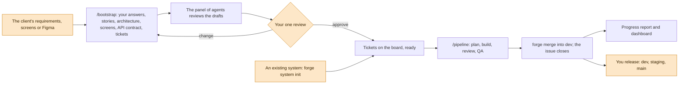

# se-forge

**A team of AI agents in Claude Code that builds client apps from requirements to merged, tested code, under
safety rules it cannot talk its way around.** You give it the client's requirements and screens; it asks you what
they leave open, writes the stories, the architecture, the screens and the API contract, cuts the work into
tickets, and then plans, builds, reviews, tests and merges them one by one, while you make the decisions. It can
also work in an existing system of several repositories.

- **A team, not one chatbot.** 22 agents with one job each: a planner, analysts, a designer and an architect;
  database, backend, frontend, mobile and devops engineers; code, security, contract, database, infrastructure,
  UI and performance reviewers; QA; a project manager; and a lead that runs them.
- **Rules that hold.** A safety layer of Claude Code hooks checks every command and file write before it runs:
  no pushes to protected branches, no secrets read or committed, no "done" without green tests, no merge without
  passing reviews, and the risky steps wait for a person.
- **Production quality by default.** Contract-first APIs (OpenAPI 3.1), tests on every side and end-to-end
  flows, a security review against OWASP ASVS, decision records, containers and CI from day one.
- **Nothing in the client's repository.** The kit lives beside the code, hidden from git; plans, reviews and
  settings go to a private team repository.
- **Decisions in a few keystrokes.** Whatever needs you comes as choices: pick one (A, B, C), tick any ([ ]),
  yes or no, or your own words when nothing fits. You reply `1A 2B`, not an essay.
- **You see where it goes.** Every step is recorded: a local dashboard shows time, waits for you, tokens and cost
  per ticket and per agent, the architecture, the screens, and a forecast of the finish.

Version 0.2.37. Built for Claude Code on Claude subscriptions, on macOS, with GitLab or GitHub.
New here? Read [GUIDE.md](GUIDE.md): step by step, from zero to a running build.

## How it works



Orange is yours. Everything else the agents do, and Claude Code asks you before anything risky.

```mermaid
flowchart TD
  subgraph once["Once"]
    A["A. GitLab: the group, the team repo, the kit, a CI runner"] --> B["B. Each MacBook: tools, SSH key, glab, forge, Figma"]
  end
  subgraph app["C1-C4. A new app"]
    C1["C1. A GitLab project for the app"] --> C2["C2. forge init: branches dev and staging"]
    C2 --> C3["C3. Protect the branches in GitLab"]
    C3 --> C4["C4. The client's requirements and screens into the team repo"]
  end
  subgraph boot["C5. /bootstrap"]
    D1["Stage 1 · Discovery: what the requirements leave open"] --> D1a["You answer, in rounds: the decision register"]
    D1a --> D2["Stage 2 · User stories and who may do what"]
    D2 --> D3["Stage 3 · Architecture: diagrams, decisions, targets"]
    D3 --> D4["Stage 4 · Screens: designed in Figma, or taken from the client's"]
    D4 --> D5["Stage 5 · API contract"]
    D5 --> D6["Stage 6 · Ticket drafts with estimates"]
    D6 --> D6a["Stage 7 · The panel: backend, frontend, database, security, QA, architect and project manager review the drafts"]
    D6a --> D7{"Stage 8 · One review, the panel's result first: you approve, or say what to change"}
    D7 -- "change: that stage runs again" --> D2
    D7 -- "approve" --> D8["Stage 9 · Merge requests: architecture, contract, starter code"]
    D8 --> D9["You merge them in GitLab and approve the tag api-v1.0.0"]
    D9 --> D10["The tickets are created in GitLab, labelled ai::ready"]
  end
  subgraph sys["F. An existing system of several repositories"]
    S1["system.json: the repositories, their branches and what deploys"] --> S2["forge system init: every repository cloned side by side; nothing on GitLab changes"]
    S2 --> S3["Each repository's gate, then forge save"]
    S3 --> S4["The tickets on the system's board, one repository each"]
  end
  subgraph build["C6. /pipeline"]
    E1["Project manager: the next ready ticket"] --> E2["Planner: the plan and its estimate, answered from the decision register"]
    E2 --> Q{"Questions the register, your earlier answers and the sources do not answer?"}
    Q -- "yes" --> Q1["You answer them, in one message"]
    Q -- "no" --> K{"Does the API change?"}
    Q1 --> K
    K -- "yes" --> K1["You merge the contract change and tag it"]
    K -- "no" --> G{"Security or architecture?"}
    K1 --> G
    G -- "yes" --> G1["You approve the plan before the engineers start"]
    G -- "no" --> E3["Engineers: database, then API, then UI, each with tests"]
    G1 --> E3
    E3 --> E4["Reviewers: code, security, API contract, and more as needed"]
    E4 --> E5["QA: the gates and the tests"]
    E4 -- "changes needed" --> E3
    E3 -. "a limit reached: 4 engineer lanes, 2 review rounds with blockers or 2 QA fails" .-> L1["The ticket is parked, and the next one starts"]
    L1 --> L2["You lift the limit (forge limits lift), or leave it parked"]
    L2 -. "lifted" .-> E3
    E4 -. "a finding outside the ticket: a follow-up issue" .-> FA
    E5 -- "fails" --> E3
    E5 --> E6["forge merge into dev; the issue moves to Done and closes"]
    E5 -- "in a system, a branch that deploys" --> E6P["You merge it; the lead moves the ticket to Done"]
    E6 --> E7
    E6P --> E7["The lead's progress report: merged, open, what waits for you"]
    E7 -- "next ticket" --> E1
    E7 -- "no ticket left" --> FA["Follow-ups rated P1 or P2 inside the decision register join, once"]
    FA --> E1
    FA --> FU["You choose which of the other follow-ups join"]
    FU -. "chosen" .-> E1
  end
  subgraph ship["Release"]
    F1["You test on dev"] --> F2["You merge dev into staging, then main, and tag the version"]
    F2 --> F3["Any released ticket still open closes"]
  end
  B --> C1
  B --> S1
  S4 --> E1
  C4 --> D1
  D10 --> E1
  E6 -- "when a release is due" --> F1
  classDef you fill:#fde7c8,stroke:#c77700,color:#3a2500
  class A,B,C1,C2,C3,C4,D1a,D7,D9,Q1,K1,G1,FU,F1,F2,S1,S2,S3,S4,L2,E6P you
```

<details>
<summary>The whole flow, step by step</summary>



</details>

## What is in it

### The agents
| Group | Agents | Model tier |
|---|---|---|
| Planning and design | `planner`, `product-analyst`, `contract-analyst`, `designer`, `architect` | deep (Opus) |
| Building | `db-engineer`, `backend-engineer`, `frontend-engineer`, `mobile-engineer`, `devops-engineer` | standard (Sonnet) |
| Checking | `code-reviewer`, `spec-checker`, `db-reviewer`, `infra-reviewer`, `figma-ui-reviewer`, `performance-reviewer`, `requirements-reviewer`, `qa-engineer`; `security-reviewer` on deep | standard (Sonnet) |
| Running the work | the lead (your session), `project-manager`, `owner-assistant`, `tracker-clerk`, `scout` | the lead's model; standard; fast (Haiku) |

The author of a change never reviews it. Reviewers are read-only; planners and analysts write documents only.
Each project maps the tiers to models in `project.json`, and the engineers always run on their tier.

### 67 skills
The playbooks the agents follow: the lead's `pipeline`, `bootstrap` (discovery, stories, architecture, screens,
contract, tickets, the requirements panel), `plan-ticket`, `review-pass`, `write-e2e`, `threat-model`,
`api-contract-design`, `db-migration`, `figma-align`, `release`, `handover`, `progress-report`, `ask-owner` (every
question to you as a choice), `owner-answers` (what the owner-assistant answers for you) and more, plus a guide per stack. See `core/skills/`.

### The safety layer
Claude Code hooks (`core/policy/`, Node 22, no dependencies) parse every command, through wrappers and
substitutions, and check every file write. Among what they refuse: pushing to `dev`, `staging` or `main`, force
pushes, `git add .`, skipping hooks, reading or printing secrets, `curl | sh`, `terraform apply`, dropping
tables, editing generated code or applied migrations, a ticket marked ready or done unless its gates passed on
that exact commit, a merge without passing reviews, an engineer on another model than its tier, and a commit that
adds a secret. They ask a person before: an API contract change or tag, security-sensitive and architecture
plans, new dependencies, CI changes, deploy tools. Each agent also has a context budget, after which it hands over.
Details: `core/policy/README.md`.

### The quality bar
- **API contract first.** OpenAPI 3.1 in the backend repository; a person merges each change and tags
  `api-v<version>`; API, UI and mobile work start only on an approved version (`forge api check` lints it and
  catches breaking changes; `forge api generate` builds the client).
- **Tests on every side**, the end-to-end flow each plan names, and **gates** that run inside the app's dev
  container, the same in CI and on a Mac. A ticket is done only when they pass on its last commit.
- **Reviews on every merge request:** code, security (OWASP ASVS level 2 unless the decision register says
  otherwise) and the contract, plus database, infrastructure, Figma and performance when they apply; then QA.
- **Records:** a decision register from discovery, C4 diagrams in Mermaid, MADR decision records, non-functional
  targets with their capacity math, k6 load tests where a plan has a performance gate.
- **Commits:** Conventional Commits, no kit files, no secrets, the project's own checks (git hooks).
- **Every ticket has limits** (the circuit breaker): 4 engineer lanes, 2 review rounds with blockers, 2 QA fails.
  At a limit the ticket is parked and the next one starts; only a person lifts it.

### Stacks
| Part | Supported |
|---|---|
| Backend | NestJS (TypeORM), .NET 10 (minimal APIs, EF Core), FastAPI (SQLAlchemy 2, Alembic) |
| Database | PostgreSQL, MySQL, SQL Server, MongoDB |
| Web | React with Vite, a generated API client, TanStack Query, shadcn/ui and Tailwind, i18next with Arabic RTL |
| Mobile | Flutter 3.47 (Riverpod, go_router, gen-l10n with Arabic RTL), Android builds in CI |
| Delivery | Docker Compose for the local stack, GitLab CI or GitHub Actions (secret scan, gates, image build) |
| Tracker | GitLab issues, GitHub issues or OpenProject work packages (settings in `project.openproject`, the API key in the OS keychain: GUIDE.md, G) |

`forge new` writes a working skeleton for any supported pair that passes its gate on day one.

## Quick start

Requirements (macOS): Node 22+, git, Claude Code, Docker Desktop (Compose v2), jq, and `glab` (GitLab) or `gh`
(GitHub), logged in. Recommended: gitleaks. For apps designed in Figma: Figma's Claude Code plugin. Every step in
detail: [GUIDE.md](GUIDE.md), parts A and B.

**Once per developer:** the `forge` command, the team repository, and where kit versions come from.
```bash
npm install -g git+ssh://git@gitlab.example.com/<group>/se-forge.git#v0.2.37
git clone git@gitlab.example.com:<group>/se-forge-projects.git ~/code/se-forge-projects
forge setup --team-repo ~/code/se-forge-projects --kit-repo git@gitlab.example.com:<group>/se-forge.git
```
From a local clone instead: `npm install -g git+file://<path to se-forge>#v0.2.37` and
`--kit-repo <path to se-forge>`. Each project pins its own kit version (fetched by tag, cached in
`~/.cache/se-forge/kits/`), so updating the global `forge` changes no project.

**A new app** (GUIDE.md, part C):
```bash
cd ~/code/clinic-booking                       # a clone of the app's empty repository
forge init --project clinic-booking --new --client "Client name"
mkdir -p .forge/project/bootstrap/inputs && cp ~/Downloads/requirements.pdf .forge/project/bootstrap/inputs/
claude                                          # then: /bootstrap .forge/project/bootstrap/inputs/requirements.pdf
                                                # and, once you approve: /pipeline next 1
```

**An existing system of several repositories** (GUIDE.md, part F):
```bash
forge system check system.json                  # the repositories, their branches and deploys, the board
forge system init --system acme --from system.json
cd ~/code/acme && claude                        # the lead, across every repository: /pipeline next 1
```
Each repository is a local clone: its `origin`, branches, pipelines and deploys stay as they are. Each ticket
changes one repository, in a worktree the lead opens there (`forge lane open`), under that repository's own gate
and rules; a merge into a branch that deploys waits for a person. Reading a whole system into documents
(`/onboard`) and change requests (`/change`) are the next phases ([the plan](docs/system-mode-plan.md)).

## Commands

In Claude Code:

| Command | What it does |
|---|---|
| `/bootstrap <requirements>` | From the client's requirements to approved stories, architecture, screens, contract and tickets |
| `/pipeline next [n]` | The lead works the queue: plan, build, review, QA, merge, report |
| `/ticket <id>` | Light mode: one agent plans and builds a small ticket, separate reviewers check it |
| `/progress-report` | Where the project stands, what waits for you, the forecast |
| `/backend-change` | Another team's API changed: compare it with the contract, the stories and the code, and plan the work |
| `/review`, `/qa`, `/figma-check`, `/next-ticket` | One step on its own |
| `/pause`, `/resume` | Stop safely before closing the laptop; carry on later, also after a kit upgrade |

In a terminal (`forge help` for every option; one page for the team: [docs/cheat-sheet.md](docs/cheat-sheet.md)):

| Command | What it does |
|---|---|
| `forge setup`, `forge init`, `forge sync`, `forge upgrade --to <v>` | Set up a machine, connect a project, regenerate its files, move it to another kit version |
| `forge doctor` | Health check; every ✗ or ! line says what to do |
| `forge save` | Send plans, reviews and reports to the team repository |
| `forge gates`, `forge merge <ticket>` | The "done" check on a branch; the lead's merge into `dev` once gates and reviews pass |
| `forge tracker …` | The project's GitLab or GitHub issues, or OpenProject work packages: list, get, create, move, comment |
| `forge api check \| fetch \| generate` | Lint the contract and catch breaking changes; the pinned spec; the generated client |
| `forge new …` | A starter skeleton for the approved stack |
| `forge app [up \| down]` | Build, start and open the app on this Mac from its Compose file |
| `forge limits [lift <ticket>]` | Each open ticket's use of its limits; a person gives a parked ticket one more try |
| `forge timeline [<ticket>]`, `forge metrics <ticket>` | Where a ticket's time and tokens went |
| `forge dashboard [--watch \| --text]` | The project on one local page, or as text |
| `forge shot <image> "<what>"` | Keep a picture of the app for the dashboard |
| `forge system check \| init`, `forge lane open \| close` | An existing system: its description, its workspace, an agent's worktree in a member repository |
| `forge worktrees`, `forge handover <name>`, `forge pacing` | The agents' worktrees; a handover; the subscription's usage |

## Measure and improve

The hooks record every step of every session in `.forge/state/` (never your messages, file contents or command
output; secrets masked), at no token cost. `forge dashboard` turns it into one local page in nine tabs:

| Tab | Shows |
|---|---|
| Overview | the project over time, with every wait for you and every screenshot; progress and the forecast of the finish; the issues by status over time |
| Architecture | the app as designed and as it runs, the requirements with a **Download the SRS** button, the decision records, the non-functional requirements, the API endpoints and the standards |
| Time | where each ticket's time goes, and the waits for you by kind |
| Cost | per ticket by model and by stage, per role, per token kind, per day (in dollars once prices are set) |
| Quality | rework after review blockers, and the refusals and failures by role |
| Agents & skills | when sub-agents ran and the skills each had (preloaded or opened itself), by day, by role and by skill; the skills never used; what the lead did itself |
| Screens | the app's screenshots, kept by QA when a UI ticket passes |
| Run the app | whether it runs now, and the commands to start and stop it |
| Tickets | every ticket, the unpicked ones too, with its status on the board, tokens, cost, agents, rounds and estimate; its number opens its issue, ▸ opens its agents one by one with their skills; in a system, a Repo column and filter |

`--watch` keeps the open page current. After each merge the lead writes a progress report from the same numbers.
Reference: [docs/metrics.md](docs/metrics.md); how to read it: GUIDE.md, part E.

## How a project is wired

In the client checkout, `forge init` makes these changes, none of them visible to git:
- it links `.forge/project` to the project's folder in the team repository (created with `--new`);
- it copies the pinned kit in: the safety engine to `.forge/kit/`, agents, skills and commands to
  `.claude/agents|skills|commands/`, hooks and permissions into `.claude/settings.local.json`;
- it lists every file it wrote, by exact path, in `.git/info/exclude`;
- it points git at the kit's git hooks; a hooks path the project already had (husky, lefthook) still runs after
  them;
- it creates `dev` and `staging` from `main` when they are missing, without pushing them. A person pushes and
  protects all three (`core/server/<host>.md`): tickets merge into `dev`, people promote `dev` → `staging` →
  `main`.

It never touches the client's own `CLAUDE.md`, `AGENTS.md`, `.claude/settings.json` or `.claude/` files; a name
clash stops it. Fill in `project.json` (stack, gate command, Figma, API client) and run `forge save`. An existing
single repository is onboarded with the skill `onboard-repo`.

**Customizing.** Overrides live in the team repository, never in the generated files (`forge sync` refuses to
overwrite a file edited in place):
```
se-forge-projects/<project>/kit/
  roles/<name>.md            replaces or adds an agent (same format as core/roles)
  skills/<name>/SKILL.md     replaces or adds a skill
  commands/<name>.md         replaces or adds a slash command
  rules.md                   extra rules injected after the kit's rules
```
Then `forge sync` and `forge save`; teammates `git pull` in the team repository and `forge sync`.

**Models.** `project.json` maps the tiers to models, `"models": { "fast": "haiku", "standard": "sonnet", "deep":
"opus" }` by default; an alias or a full model name (`claude-opus-5-5`), then `forge sync`. The hook refuses an
engineer spawn on another model than its tier's (decision 94).

**Prices.** `"prices"` in `project.json` (US dollars per million tokens, per model family, set by a person) turns
tokens into dollars in `forge timeline` and the dashboard.

**Upgrading.** At a stop (`/pause`): install the same version of `forge` (`npm install -g …#v0.2.37`), then
`forge upgrade --to 0.2.37` and `forge save`, and start a fresh session; `/resume` has the lead read what changed
and follow the new skills over its old handover. Teammates install the same `forge` and run `forge sync`; until
they do, their agents may only read. Each project moves on its own schedule. The first time Claude Code opens a
project, accept the "trust this folder" dialog.

**Pacing** (optional, Claude subscriptions only): `forge setup --pacing on`, then `forge sync`. A status line
records the plan's 5-hour and weekly usage; near the limit new agents are refused, running ones hand over, and the
lead schedules a `/resume` at the reset. `forge pacing` shows the level.

**CI** (`core/ci/`, skill `ci-pipeline`): `secret-scan`, `gates` (the gate inside the dev image) and
`build-image`, for GitLab CI and GitHub Actions. Server setup (branch protection, required checks, protected
environments): `core/server/`.

## Layout

```
core/                 the kit, tool-neutral
  AGENTS.md           rules for every agent (injected at session start)
  LANES.md            extra rules for spawned agents (injected at agent start)
  roles/              one file per agent: tier, access (code | docs | read-only), the skills it preloads, instructions
  skills/             one folder per skill (Agent Skills format)
  policy/             the safety engine (Node 22+, no dependencies); see core/policy/README.md
  cli/                the forge command (dashboard/: forge dashboard)
  githooks/           pre-commit and commit-msg checks
  tracker/            the tracker front door and its GitLab, GitHub and OpenProject adapters
  starter/            the skeletons forge new writes
  ci/  server/        CI jobs, and server setup checklists for GitHub and GitLab
adapters/claude/      Claude Code wiring: roles -> agents, commands, the local settings template
extras/pacing/        the optional status line that records plan usage
docs/                 the cheat sheet, the metrics reference, every decision, the system mode plan
tests/                unit and integration tests; tests/stacks, tests/ci and tests/starter run real containers;
                      tests/live runs real Claude Code sessions
```

## Status

Version 0.2.37 ([CHANGELOG.md](CHANGELOG.md)). Built and tested: the safety layer, the full-stack roles and stack
guides, discovery-first bootstrap with the requirements panel, the pipeline with tickets that close on merge and
follow-ups by priority, mobile apps in Flutter, local containers and CI, architecture records and load tests, the
starter, the dashboard, per-ticket limits, and the first phase of system mode. Every choice is a numbered decision
(134 so far) in [docs/decisions.md](docs/decisions.md), which the code and the skills cite.

Next: reading an existing system into documents (`/onboard`) and change requests (`/change`), the whole system
running locally, staging and production deploys, a limit for a whole build (by date or cost), and several
tickets at once. Not supported: Windows, and coding tools other than Claude Code.

## Working on the kit

- `npm test`: the unit and integration tests.
- `forge sync` in a test project linked to this checkout's version.
- `node tests/live/live-harness.mjs [scenario]`: real Claude Code sessions, run by hand (costs money).
- `tests/stacks/run.sh <stack>`, `tests/ci/run.sh`, `tests/starter/run.sh`: the stacks, CI and starters in real
  containers (Docker).

A release is a `VERSION` bump, a `CHANGELOG.md` entry and a `vX.Y.Z` tag equal to `VERSION` (CI checks it).
Changes go through a merge request.

## License

[MIT](LICENSE).
